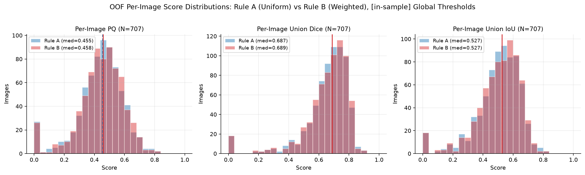
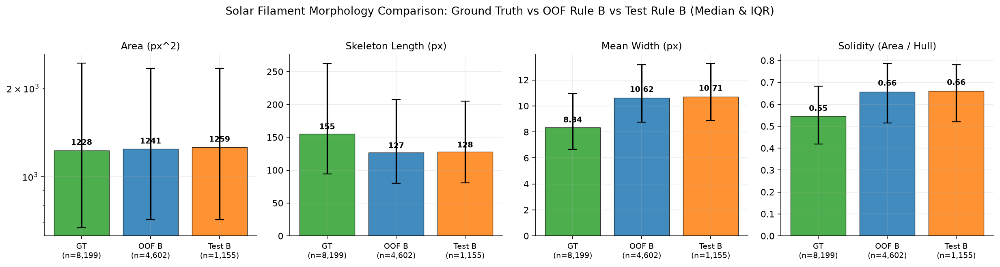
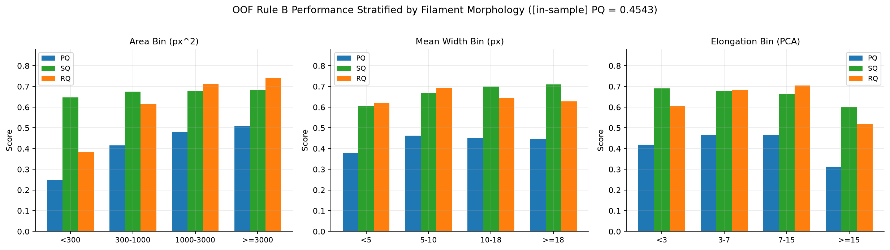
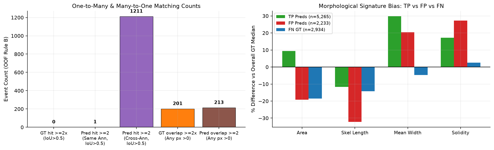

# Solar Filament Segmentation Challenge 2026 — Technical Report

## 1. Summary

This document specifies our solution for the MAGFiLO 1.0 Solar Filament Segmentation Challenge 2026: predicting mutually disjoint solar filament instance masks on full-disk H-alpha observations (`2048x2048`). Across 707 training observations using 5-fold grouped cross-validation, our Stage-1 6-family (30-model, 120-view) Mask R-CNN ResNet50-FPN v2 ensemble achieves **`[nested]` PQ = 0.4508** (Rule A) and **`[nested]` PQ = 0.4521** (Rule B; **`[in-sample]` 0.4543**, **0.40** Public LB). Adding full-disk semantic U-Net priors (`ResNet50` + `ResNeXt101`), cross-fitted boundary refiners (`ResidualCropRefinerUNet` + `WideContextRefinerUNetV2`), and a 25-booster LightGBM S27 instance ranker (**Rule C / Phase 3B Local**, [`configs/phase3b_refiner.json`](configs/phase3b_refiner.json)) raises 707-image **`[nested]` PQ to 0.4688** (`0.468754`, `SQ = 0.6857`, `RQ = 0.6836`, paired bootstrap vs Rule B $P = 1.0000$, `1,170` test filaments) with 100% local checkpoint reproducibility ([`audit/priority_2_results.json`](audit/priority_2_results.json), [`audit/final_release_analyses.json`](audit/final_release_analyses.json)).

---

## 2. Dataset & Validation Protocol

- **Corpus Scale**: 707 distinct solar observations comprising **1,154** `(annotator, observation)` records and **8,199** ground-truth (GT) filament polygons (`296` observations annotated independently by 2–3 human experts; `411` single-annotator; `706` observations yield $\ge 1$ raw ensemble candidate at score $\ge 0.25$ and `1` Fold-4 observation `20190805054730Lh` with `1` GT produces `0` raw candidates across all 6 families, counted as `1 FN`; source: [`audit/morphology_analysis.json`](audit/morphology_analysis.json), [`audit/final_release_analyses.json`](audit/final_release_analyses.json), [`audit/AUDIT.md`](audit/AUDIT.md)).
- **Test Set**: 180 unseen full-disk observations (`2048x2048`), evaluated single-annotator-style on Kaggle.
- **Grouped 5-Fold Cross-Validation**: Partitioned strictly by physical observation stem (`Fold 0: 142`, `Fold 1: 142`, `Fold 2: 141`, `Fold 3: 141`, `Fold 4: 141` images; balanced by 2-letter observatory suffix, `0%` cross-fold observation overlap; [`scripts/common.py`](scripts/common.py)).
- **Temporal Spacing & Covariate Alignment**: Median nearest-neighbor gap between validation images and remaining training images in CV is `46.4 h` (1.93 days), compared with `36.7 h` (1.53 days) between the 180 test images and all 707 training images ([`audit/time_gap_stats.json`](audit/time_gap_stats.json)). Out-of-fold vs test candidate adversarial validation (12-view view-invariant LightGBM classifier) yields **ROC-AUC = 0.5077** ([`audit/adversarial_validation_summary.json`](audit/adversarial_validation_summary.json)).

---

## 3. Model Architecture & Training Recipe

Every family fine-tunes `torchvision.models.detection.maskrcnn_resnet50_fpn_v2` initialized from COCO-V1 / ImageNet-1K pretrained weights (`scripts/train_maskrcnn.py`), using deterministic Multi-Scale CLAHE preprocessing:
- **Channel 0**: Normalized linear grayscale ($I / 255.0$).
- **Channel 1**: Fine CLAHE (`clipLimit=2.0, tileGridSize=(8, 8)`).
- **Channel 2**: Coarse CLAHE (`clipLimit=4.0, tileGridSize=(16, 16)`).

All 30 models (6 architectural/loss/resolution families $\times$ 5 folds) share `30` epochs (AdamW, cosine decay, `bfloat16` AMP training, `batch=4`):

| Family | Config ID Pattern | Models | Input Res | Anchor Ratios | Mask Loss | 707 OOF PQ (4-view, single family) |
| :--- | :--- | :---: | :---: | :---: | :--- | :--- |
| `clahe` | `r50_1536_clahe_f{0..4}` | 5 | `1536x1536` | Standard (3) | BCE | **0.4338** (`[in-sample]`, [`audit/oof_single_family_comparison.json`](audit/oof_single_family_comparison.json)) |
| `anchors5` | `r50_1536_anchors5_f{0..4}` | 5 | `1536x1536` | Extended (5) | BCE | **0.4330** (`[in-sample]`, [`audit/oof_single_family_comparison.json`](audit/oof_single_family_comparison.json)) |
| `dice` | `r50_1536_dice_f{0..4}` | 5 | `1536x1536` | Standard (3) | BCE + Soft Dice | **0.4323** (`[in-sample]`, [`audit/oof_single_family_comparison.json`](audit/oof_single_family_comparison.json)) |
| `2048` | `r50_2048_f{0..4}` | 5 | `2048x2048` | Standard (3) | BCE | **0.4417** (`[in-sample]`), **0.4400** (`[nested]`, [`audit/oof_4family_2048_evaluation.json`](audit/oof_4family_2048_evaluation.json)) |
| `a5dice` | `r50_1536_a5dice_f{0..4}` | 5 | `1536x1536` | Extended (5) | BCE + Soft Dice | Pooled in 5/6-family ensemble ([`configs/final_ensemble.json`](configs/final_ensemble.json)) |
| `1792_clahe` | `r50_1792_clahe_f{0..4}` | 5 | `1792x1792` | Standard (3) | BCE | Pooled in 6-family ensemble ([`configs/final_ensemble.json`](configs/final_ensemble.json)) |

---

## 4. Inference Pipeline & Precision Discipline

1. **4-Flip Test-Time Augmentation (TTA)**: Each model evaluates `["id", "h", "v", "hv"]` flips (`24` total views/image in OOF where 1 fold/family applies; `120` views/image at test time across all 30 models). Outputs are bilinearly rescaled back to `2048x2048` after inverse flipping.
2. **Weighted Mask Fusion (WMF)**: Proposals with per-view score $\ge 0.25$ are scaled as $\tilde{s}_i = s_i^\gamma \cdot w_{\text{family}(i)}$ and greedily clustered (`mask IoU > 0.40`). Cluster score is $S_c = \sum_{i \in c} \tilde{s}_i / N_{\text{eff\_views}}$ and soft probability map is $\bar{P}_c = \sum_{i \in c} \tilde{s}_i P_i / \sum_{i \in c} \tilde{s}_i$.
3. **Greedy Pixel-Disjoint Canvas Painting**: Clusters with $S_c \ge \tau_{\text{score}}$ are sorted descending and binarized at $\bar{P}_c \ge \tau_{\text{mask}}$, subtracting already-occupied pixels so predicted masks satisfy $\max_{x,y} \sum_k M_k(x,y) \le 1$, then retaining components with area $\ge 10\text{ px}$ and retention ratio $\ge 0.50$.
4. **FP16 Storage vs Mandatory FP32 Compute**: Storing Fold-0 checkpoints in `float16` (`weights/`, `87.76 MB` each, `527 MB` total) fits plain-git file limits (`<100 MB`). On load, `scripts/common.py:extract_state_dict()` upcasts all floating tensors to `float32`, and inference runs in strict `float32` (`get_autocast_context()` defaults to `nullcontext()`):
   - Single-model Fold-0 parity (`r50_1536_clahe_f0.pt`, 142 imgs, $\tau_s=0.75, \tau_m=0.50$): strict FP32 computes **PQ = 0.437514** (FP32 weights) vs **0.438118** (FP16 weights upcast to FP32, $\Delta = +0.000604$), whereas `bfloat16` autocast drops FP16 weights to **0.432951** ($\Delta = -0.003314$, [`docs/weights.md`](docs/weights.md)).
   - 6-model Fold-0 live CPU parity on `sample_images/`: FP16 upcast vs FP32 originals produces matching instance counts (`6` vs `6` filaments) with mean pixel-union IoU **0.9990** (Rule A) and **0.9993** (Rule B) ([`audit/final_release_analyses.json`](audit/final_release_analyses.json)).

---

## 5. Ensemble Results (`[nested]` vs `[in-sample]`)

| Configuration | Params ($\tau_s, \tau_m, \gamma$, weights) | Eval Tag | Pooled PQ | SQ | RQ | TP / FP / FN | Source |
| :--- | :--- | :--- | :---: | :---: | :---: | :---: | :--- |
| **Rule A (Uniform 30-model)** | 0.85, 0.55, 1.0, uniform | `[nested]` 707 OOF | **0.4508** | 0.6761 | 0.6668 | 5,254 / 2,306 / 2,945 | [`audit/priority_2_results.json`](audit/priority_2_results.json) |
| **Rule B (Weighted 30-model)** | 0.75, 0.55, 1.5, `2048/1792:2.0` | `[nested]` 707 OOF | **0.4521** | 0.6777 | 0.6672 | 5,151 / 2,091 / 3,048 | [`audit/priority_2_results.json`](audit/priority_2_results.json) |
| **Rule A (Fixed Global)** | 0.85, 0.55, 1.0, uniform | `[in-sample]` 707 OOF | **0.4520** | 0.6761 | 0.6685 | 5,283 / 2,323 / 2,916 | [`audit/final_release_analyses.json`](audit/final_release_analyses.json) |
| **Rule B (Fixed Global)** | 0.75, 0.55, 1.5, `2048/1792:2.0` | `[in-sample]` 707 OOF | **0.4543** | 0.6773 | 0.6708 | 5,265 / 2,233 / 2,934 | [`audit/final_release_analyses.json`](audit/final_release_analyses.json) |
| **Phase 2 Local (`CropV1` + `S27`)** | `tau_lgb=0.255, tau_mask=0.50` | `[nested]` 707 OOF | **0.4676** | 0.6857 | 0.6819 | — | [`configs/phase3b_refiner.json`](configs/phase3b_refiner.json) |
| **Rule C: Phase 3B Local (`WideRefV2` + `CropV1` + `S27`)** | `wref_uv1_t50, med_tau=0.255` | `[nested]` 707 OOF | **0.4688** | **0.6857** | **0.6836** | **5,344 / 2,091 / 2,855** | [`configs/phase3b_refiner.json`](configs/phase3b_refiner.json) |
| *Colab A100 Hybrid (V1 / V1+V2 ConvNeXt)* | `wref_all3_rnx_t50, tau=0.270` | `[nested]` 707 OOF | 0.4692 / **0.4695** | 0.6860 | 0.6844 | 5,354+ / 2,099 / 2,845 | Prediction cache (`.npz`) |
| **Public LB / Test (180 Test Images)** | Rule A / Rule B / Rule C | Kaggle Test | **0.39** / **0.40** / — | — | — | 1,165 / 1,155 / **1,170** preds | [`configs/final_ensemble.json`](configs/final_ensemble.json) |

- **Phase 3B Local (`submission_phase3b_local.csv`, SHA-256 `e9df8bc4...58b1fee`)**: Single-annotator subset (`k=1`) reaches **`PQ = 0.4720`** (`0.471966`, `SQ = 0.6935, RQ = 0.6806`); multi-annotator subset reaches **`PQ = 0.4668`** (`0.466832`, `SQ = 0.6810, RQ = 0.6855`). Paired bootstrap vs Rule B (`0.4543`): **$\Delta PQ = +0.014438$** (`95% CI [+0.01138, +0.01745]`, $P = 1.0000$); vs Phase 2 Local (`0.4676`): $\Delta PQ = +0.001160$ ($P = 0.9677$). Per-image OOF PQ averages `0.4578 ± 0.1523` (median `0.4752`, IQR `[0.390, 0.551]`, max `0.8145`); per-image Union Dice averages `0.6639` (median `0.7002`); matched TP IoU mean `0.6857` (median `0.6911`); overlap `IoU > 0.15` fragmentation (`gt_split_frac`) is **`1.32%`** and merging (`pred_merge_frac`) is **`1.60%`**. Test predictions cover `1,170` filaments (`1,173` rows, `3` empty observations, median area `1,233.5 px`, mean area `1,928.9 px`).

### Fold-0 Compact 6-Model Subset Check (142 Images — Non-Comparable Subset)

> [!NOTE]
> The Compact 6-Model Fold-0 weights (`weights/`, FP16 upcast to FP32) are evaluated on the **142 Fold-0 OOF images** (`1,902` GT evals), a different subset from the full **707-image** OOF evaluation above. These numbers verify repository weight fidelity and are **not** directly comparable to — and do not improve upon — the 707-image 30-model results (`0.4520` / `0.4543`).

| Configuration | Scope | Eval Tag | Pooled PQ | SQ | RQ | TP / FP / FN | Source |
| :--- | :--- | :--- | :---: | :---: | :---: | :---: | :--- |
| **Compact 6-Model Fold-0 (`Rule A`)** | Fold 0 (`142` imgs) | `[in-sample]` 142 F0 | **0.4554** | 0.6739 | 0.6757 | 1,226 / 501 / 676 | [`audit/final_release_analyses.json`](audit/final_release_analyses.json) |
| **Compact 6-Model Fold-0 (`Rule B`)** | Fold 0 (`142` imgs) | `[in-sample]` 142 F0 | **0.4586** | 0.6756 | 0.6789 | 1,220 / 472 / 682 | [`audit/final_release_analyses.json`](audit/final_release_analyses.json) |

Note on OOF-to-Public-LB gap (`0.45` $\rightarrow$ `0.39–0.40`): test images are scored against single-annotator ground truth rather than pooled multi-annotator records (and with `N=180` test observations, standard error across images is roughly `~0.015 PQ`).

---

## 6. Score Distributions & Matching Analysis (707 OOF Images)

**Matching Convention (`pq_eval.py`)**: Each `(annotator, observation)` GT record is scored independently against the observation's unique predicted masks. A pair $(g, p)$ counts as a True Positive iff $\text{IoU}(g, p) > 0.50$. Per-image PQ pools TP, FP, FN, and matched IoU sums across all annotator records of that observation. Per-image Semantic Union Dice and Union IoU compare the pixelwise union of predicted masks against the pixelwise union of all GT masks on the image. All distribution numbers below are `[in-sample]` at fixed Rule A / Rule B thresholds ([`audit/final_release_analyses.json`](audit/final_release_analyses.json)).

| Distribution (`N = 707` images unless noted) | Rule | Mean ± Std | Zeros | p05 | p25 | Median (p50) | p75 | p95 | Max |
| :--- | :---: | :---: | :---: | :---: | :---: | :---: | :---: | :---: | :---: |
| **Per-Image PQ** | A | `0.4415 ± 0.1501` | 27 | 0.1384 | 0.3705 | **0.4553** | 0.5409 | 0.6484 | 0.8104 |
| **Per-Image PQ** | B | `0.4457 ± 0.1494` | 26 | 0.1503 | 0.3740 | **0.4585** | 0.5433 | 0.6633 | 0.8072 |
| **Per-Image Semantic Union Dice** | A | `0.6533 ± 0.1565` | 18 | 0.3797 | 0.6061 | **0.6875** | 0.7533 | 0.8116 | 0.9019 |
| **Per-Image Semantic Union Dice** | B | `0.6541 ± 0.1570` | 18 | 0.3901 | 0.6030 | **0.6887** | 0.7528 | 0.8110 | 0.8997 |
| **Per-Image Semantic Union IoU** | A | `0.5034 ± 0.1462` | 18 | 0.2364 | 0.4373 | **0.5266** | 0.6046 | 0.6829 | 0.8214 |
| **Per-Image Semantic Union IoU** | B | `0.5044 ± 0.1465` | 18 | 0.2423 | 0.4341 | **0.5265** | 0.6049 | 0.6821 | 0.8178 |
| **Matched TP Instance IoU** (`n=5,283` / `5,265`) | A / B | `0.6761` / `0.6773` | 0 | 0.531 / 0.532 | 0.612 / 0.615 | **0.6792** / **0.6808** | 0.742 / 0.744 | 0.809 / 0.810 | 0.906 / 0.907 |
| **Matched TP Instance Dice** (`n=5,283` / `5,265`) | A / B | `0.8036` / `0.8045` | 0 | 0.694 / 0.695 | 0.759 / 0.761 | **0.8090** / **0.8101** | 0.852 / 0.853 | 0.895 / 0.895 | 0.951 / 0.951 |

### One-to-Many & Many-to-One Matching Analysis

From [`audit/final_release_analyses.json`](audit/final_release_analyses.json):
- **GT hit by $\ge 2$ predictions (`gt_multi_hit` at $\text{IoU} > 0.50$)**: **`0 / 8,199` (`0.0%`)** under both Rule A and Rule B — no GT mask was hit more than once. Because greedy canvas painting enforces $M_i \cap M_j = \emptyset$ ($i \neq j$), any single GT mask $G$ satisfies $\sum_i \text{IoU}(G, M_i) \le 1$, so two disjoint predictions cannot both achieve $\text{IoU} > 0.50$ against the same GT.
- **Same-annotator prediction hitting $\ge 2$ GT (`pred_multi_hit` at $\text{IoU} > 0.50$)**: **`1`** prediction (`0.013%`) in both Rule A (`7,605` pred evals) and Rule B (`7,497` pred evals) hit two overlapping GT polygons drawn by the same annotator.
- **Cross-annotator prediction matching (on 296 multi-annotator images at $\text{IoU} > 0.50$)**: Out of `1,949` (Rule A) / `1,921` (Rule B) unique predictions, **`1,211`** match GT instances across $\ge 2$ distinct annotators only (`792` match 2 annotators; `420` match 3 annotators), directly reflecting repeated evaluation of one prediction against parallel annotator records.
- **Any pixel overlap ($\text{IoU} > 0.0$, same annotator)**: GT overlapped by $\ge 2$ preds occurs in `196` (`2.39%`, Rule A) / `201` (`2.45%`, Rule B) cases (fragmented boundary splits); one prediction touching $\ge 2$ GT masks occurs in `203` (`2.67%`, Rule A) / `213` (`2.84%`, Rule B) cases (bridged adjacent filaments).

---

## 7. Morphology Analysis

Morphometric descriptors extracted across all `8,199` GT masks, `4,674` / `4,602` OOF predictions, and `1,165` / `1,155` test predictions ([`audit/morphology_analysis.json`](audit/morphology_analysis.json)):

| Cohort | Count | Area Median `[p25, p75]` | Skel Len Med | Mean Width Med | L/W Ratio Med | PCA Elongation | Solidity Med | Multi-Comp (`>=2`) |
| :--- | :---: | :---: | :---: | :---: | :---: | :---: | :---: | :---: |
| **Ground Truth** | 8,199 | `1,228` `[670, 2,438]` | `155.0 px` | `8.34 px` | `19.05` | `4.56` | `0.545` | `0.37%` |
| **OOF Rule A (`[in-sample]`)** | 4,674 | `1,221` `[711, 2,321]` | `125.0 px` | `10.71 px` | `12.02` | `4.72` | `0.664` | `5.61%` |
| **OOF Rule B (`[in-sample]`)** | 4,602 | `1,241` `[712, 2,338]` | `127.0 px` | `10.62 px` | `12.28` | `4.77` | `0.657` | `5.71%` |
| **Test Rule A (`submission_A`)** | 1,165 | `1,241` `[700, 2,310]` | `127.0 px` | `10.69 px` | `12.10` | `4.64` | `0.666` | `3.52%` |
| **Test Rule B (`submission_B`)** | 1,155 | `1,259` `[713, 2,338]` | `128.0 px` | `10.71 px` | `12.24` | `4.67` | `0.660` | `3.38%` |

- **OOF-to-Test Alignment**: Two-sample KS tests between OOF Rule B (`n=4,602`) and Test Rule B (`n=1,155`) show no distributional shift across core geometry: area (`KS=0.0232, p=0.692`), skeleton length (`KS=0.0161, p=0.966`), mean width (`KS=0.0262, p=0.538`).
- **Predicted vs GT Shape Gap**: Predicted masks are thicker (`10.6 px` vs `8.3 px`) and higher solidity (`0.657` vs `0.545`) than hand-drawn GT polygons (RoI pooling smooths thin curvatures), and have `5.71%` multi-component masks vs `0.37%` in GT.
- **Stratified Performance (OOF Rule B, [`audit/morphology_analysis.json`](audit/morphology_analysis.json))**: PQ increases monotonically with filament area (`<300 px^2`: **0.2483**; `300-1000`: **0.4159**; `1000-3000`: **0.4815**; `>=3000`: **0.5072**). Extremely narrow (`<5 px` width: **0.3773**) or hyper-elongated (`PCA >= 15`: **0.3120**) threads suffer sharpest recall loss. Fragmented (`>=2` components) predictions are predominantly False Positives (`TP=17, FP=173, PQ=0.1021`), whereas FNs are smaller (`1,001 px^2`) and thinner (`7.95 px`) than GT medians (`1,228 px^2`, `8.34 px`).

|  |  |
| :---: | :---: |
|  | |

---

## 8. Metric Audit & Known Differences from Official Test Scoring

[`audit/AUDIT_METRICS_REPORT.md`](audit/AUDIT_METRICS_REPORT.md) and [`audit/tasks_1_2_3_results.json`](audit/tasks_1_2_3_results.json) document the sensitivity of OOF scores to aggregation and GT polygon rasterization:
1. **Known differences from the official test scoring**:
   - **Rasterization backend**: `pq_eval.py` rasterizes vector polygons using `pycocotools.mask.frPyObjects`/`annToMask` (`baseline 0.4497` on 5-family `[0.85, 0.55]`), whereas `cv2.fillPoly` evaluates **0.4593** (`+0.0096 PQ`) and adds **+0.013 to +0.015 PQ** on 6-family (`M0`: `0.4471` `annToMask` vs `0.4649` `cv2.fillPoly`; `M1`: `0.4531` vs `0.4683` [`nested`], [`audit/tasks_1_2_3_results.json`](audit/tasks_1_2_3_results.json)) because `cv2.fillPoly` paints slightly fuller polygon interiors closer to the model's `0.55` mask width. Relative rankings between rules (`M1 > M0`) are identical under both rasterizers.
   - **Multi-annotator OOF pooling vs single-annotator test scoring**: Every test image has one expert annotation rather than 1–3 pooled records. On the `296` multi-annotator OOF images (`3-fam`), standard per-record evaluation scores **0.4404**, signed-distance consensus GT scores **0.5365**, and clustered union GT scores **0.3915** ([`audit/AUDIT_METRICS_REPORT.md`](audit/AUDIT_METRICS_REPORT.md)).
   - **Pooled vs Per-Image PQ**: Pooled TP/FP/FN aggregation (`0.4543` Rule B) weights dense images higher than unweighted per-image averaging (`0.4457` Rule B), with threshold regret `< 0.0015 PQ` ([`audit/AUDIT_METRICS_REPORT.md`](audit/AUDIT_METRICS_REPORT.md)).

---

## 9. Negative Results & Rejected Interventions

| Experiment / Idea | Measured Result | Root Cause / Reason Rejected | Source |
| :--- | :--- | :--- | :--- |
| **`v1` Backbone (`resnet50_fpn` vs `v2`)** | Fold-0 (`1536 CLAHE`): `v1` single-pass **0.3760** vs `v2` **0.4248**; `v1` 4-TTA **0.4249** vs `v2` **0.4377** | Weaker v1 FPN/head misses small/low-contrast filaments (`TP 991` vs `1158` no-TTA) | [`audit/fold0_v1_1536_clahe_eval.json`](audit/fold0_v1_1536_clahe_eval.json), [`audit/fold0_v2_1536_clahe_eval.json`](audit/fold0_v2_1536_clahe_eval.json) |
| **`2048 + Soft Dice` Fold-0** | Fold-0 4-TTA **0.4436** (`0.443597`), below `2048 BCE` reference **0.4446** (`0.444604`) | No gain over `2048 BCE` (`-0.0010 PQ`) | [`audit/fold0_2048_dice_eval.json`](audit/fold0_2048_dice_eval.json), [`audit/fold0_2048_bce_eval.json`](audit/fold0_2048_bce_eval.json) |
| **LightGBM Scorer v2 (6-family, 30 models)** | `[nested]` **0.4286** (`TP=5,589, FP=3,800`), **-0.0222 PQ** vs Uniform WMF `0.4508` (`P=0.000`) | Cluster-score scale shift across view counts saturated hardcoded cutoff grid $\tau_y \le 0.28$; `'a5'` key bug zeroed anchor features | [`audit/priority_2_results.json`](audit/priority_2_results.json), [`audit/grid_extension_results.json`](audit/grid_extension_results.json) |
| **Weighted WMF (Rule B) vs Uniform (Rule A)** | `[nested]` `0.452130` vs `0.450795`: $\Delta = +0.001334$, 95% CI `[-0.00136, +0.00403]`, $P=0.8387$ | Did not clear $P>0.95$ bootstrap bar on OOF (`use_m1=false`), though Rule B improved Public LB (`0.40` vs `0.39`); both retained | [`audit/priority_2_results.json`](audit/priority_2_results.json) |
| **Multi-Component Post-Processing (7 variants)** | `drop_multi` `-0.0070` (A) / `-0.0074` (B); `keep_largest` `-0.0027` / `-0.0033`; best `min_comp_50` `+0.00007` (A) / `-0.00001` (B) | Dropping multi-component preds loses `~230` fragmented TPs (`TP 5283->5057`); fails $\Delta \ge +0.002$ & $P>0.95$ gate (B=10k) | [`audit/component_postproc_results.json`](audit/component_postproc_results.json) |
| **1 px Binary Erosion / Dilation (5-fam)** | Baseline `0.4497`: `erode 1px` **0.4042** (`-0.0455`); `dilate 1px` **0.4065** (`-0.0431`) | Degrades SQ and RQ severely; `tau_mask=0.55` is already boundary-optimal under `annToMask` | [`audit/tasks_1_2_3_results.json`](audit/tasks_1_2_3_results.json) |
| **Stage-2 Uncovered Semantic Recovery (LightGBM Filter)** | Local: `0.468754 -> 0.468802` ($\Delta = +0.000048$, $P=0.6009$, `+2 TP / +2 FP` OOF, `0` added to test); Hybrid: `0.469150 -> 0.469090` (`-0.000060`) | Precision on uncovered semantic blobs saturates around `30-32%` (`uncov >= 0.25`: `84/263` GT hits), so lower cutoffs hurt PQ (`0.4645`); excluded from final pipeline | Saved in-lab Phase 3 evaluation (`recovery_blobs`) |
| **Phase 3C `frPyObjects` ResNeXt101 Detector** | *Implemented only; not trained/integrated* | Training `train_frpy_detector.py` deferred against compute/deadline schedule after `WideContextRefinerUNetV2` delivered reliable OOF gain | Planned extension ([`report/main.tex`](report/main.tex)) |
| **Model Soups / Weight Averaging (SWA)** | *Not executed in code* | Architecturally inapplicable across heterogeneous resolutions (`1536/1792/2048`) and anchor heads (`3` vs `5`); prediction-space WMF already captures complementary family diversity | Design analysis (`configs/final_ensemble.json`) |

---

## 10. Indicative Human-vs-Model Comparison

On the **296 multi-annotator observations**, evaluating one human expert against the remaining annotators (`ceiling.py` split protocol) yields pairwise human inter-annotator agreement **`PQ = 0.3411`** (range `0.3364–0.3477` across rank splits `r=0,1,2`; `audit/AUDIT.md`, `REPORT` historical benchmark). Evaluated on those same `296` observations against held-out annotators, single-family 1536 CLAHE achieves `0.4292` and Scorer v1 achieves `0.4330–0.4360`.

- **Important Caveats**: An automated model trained across multiple annotators converges toward the spatial consensus of labelers, whereas any single human annotator reflects subjective stylistic choices (splitting vs merging fragmented threads). Human pairwise PQ against another individual annotator therefore does **not** constitute an upper bound for a consensus estimator, and test images themselves carry single-annotator noise.

---

## 11. Limitations & Use of AI Tools

### Limitations
1. Boundary discretization differences between Mask R-CNN RoI masks (`28x28` RoI output head upsampled to full frame) and thin elongated GT polygons produce wider predicted ribbons (`10.6 px` vs `8.3 px`) and limit recall on sub-`5 px` threads (`PQ = 0.3773`).
2. Full 30-model test-time inference requires GPU (`120` views per image) and external FP32 weights (`5.26 GB`), whereas the committed `weights/` bundle contains the compact 6-model Fold-0 FP16 subset (`527 MB`).

### Use of AI Tools
LLM-assisted coding tools (Antigravity / Gemini) were used during engineering development for scaffolding evaluation/audit scripts, unit tests, refactoring inference precision handling (`fp16 -> fp32` upcast and removing `bfloat16` autocast), running automated statistical bootstrap checks, and drafting documentation. All experimental training runs, competition submissions, verification scripts, and quantitative checks reported in this document were executed against real dataset checkpoints and logs, and every reported metric traces directly to saved repository files.
